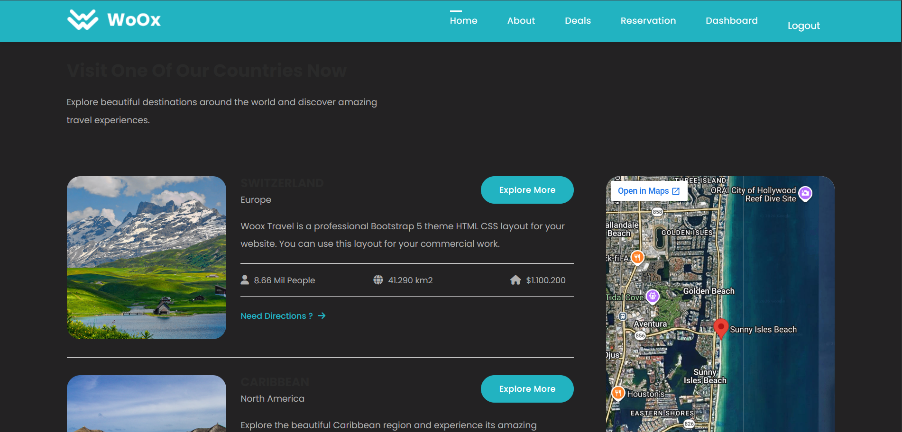
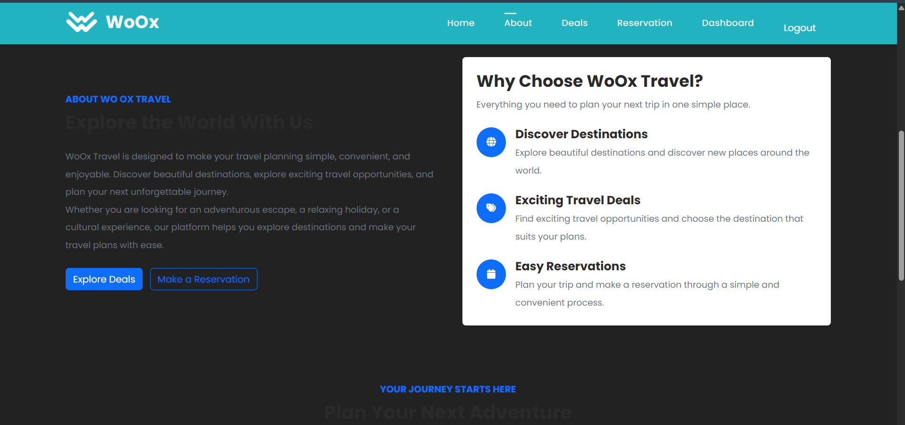
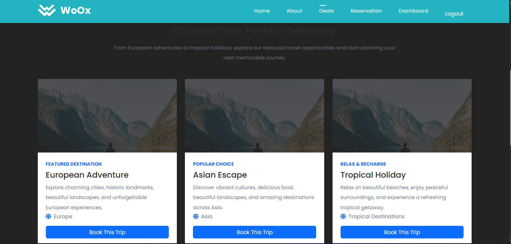
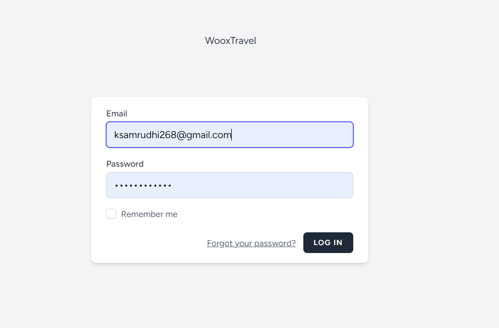
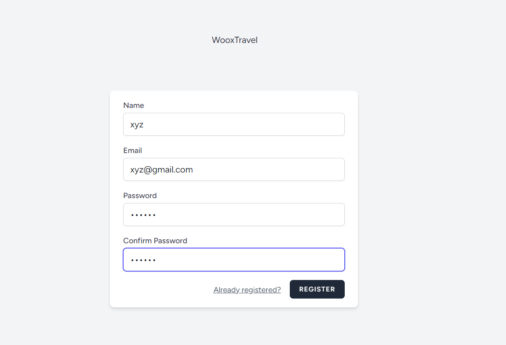
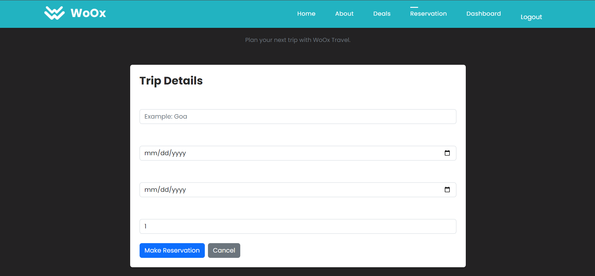
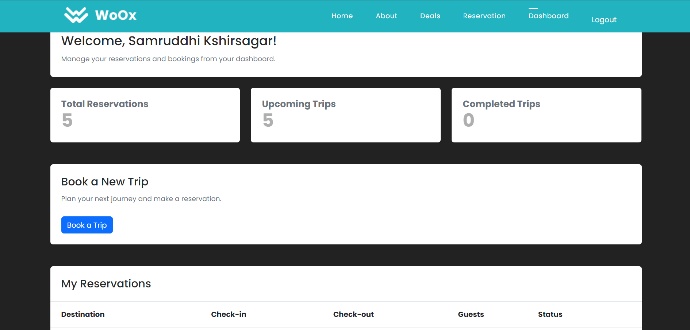

# 🌍 WoOx Travel Booking System

A full-stack travel booking web application built with **Laravel, MySQL, Blade, Bootstrap, and Laravel Breeze**. The application provides a responsive travel website where users can explore destinations and travel deals, register/login, make reservations, and manage their bookings through a personalized dashboard.

---

## 📌 Project Overview

**WoOx Travel Booking System** is a Laravel-based web application designed to provide a simple and user-friendly travel booking experience.

The application includes:

* Travel-focused home page
* About Us page
* Travel deals and destinations
* User registration and login
* Secure authentication using Laravel Breeze
* Travel reservation system
* Personalized user dashboard
* Reservation history
* Upcoming and completed trip tracking
* MySQL database integration
* Responsive Bootstrap-based UI

---

## ✨ Features

### 🏠 Home Page

* Attractive travel landing page
* Travel destinations and highlights
* Navigation to different sections of the website
* Login/Register options for visitors

### ℹ️ About Page

* Information about the travel platform
* Travel services and benefits
* Destination and booking highlights

### 🎁 Travel Deals

* Featured travel destinations
* Popular getaway sections
* Travel categories
* Destination information
* Booking call-to-action

### 🔐 Authentication

Authentication is implemented using **Laravel Breeze**.

Users can:

* Register
* Login
* Logout
* Reset password
* Verify email
* Manage authentication securely

### 📝 Reservation System

Authenticated users can create a reservation by providing:

* Destination
* Check-in date
* Check-out date
* Number of guests

Reservation information is stored in the MySQL database.

### 📊 User Dashboard

After login, users can access their personalized dashboard.

The dashboard displays:

* Total reservations
* Upcoming trips
* Completed trips
* Reservation history
* Booking details

---

# 🖥️ Screenshots

The following screenshots demonstrate the main pages and functionality of the application.

## 🏠 Home Page

The home page introduces the travel platform and provides navigation to the main sections of the application.



---

## ℹ️ About Page

The About page provides information about WoOx Travel and highlights the main features of the platform.



---

## 🎁 Travel Deals Page

The Travel Deals page displays featured destinations, popular getaways, and travel opportunities.



---

## 🔐 Login Page

Users can securely log in to their account using their registered email and password.



---

## 📝 Registration Page

New users can create an account by providing their name, email, and password.



---

## ✈️ Reservation Page

Authenticated users can make a travel reservation by entering their destination, travel dates, and number of guests.



---

## 📊 User Dashboard

The dashboard provides users with an overview of their reservations and trips.



---

## 📋 Reservation History

Users can view their previous and upcoming reservations, including destination, dates, number of guests, and reservation status.


---

# 🛠️ Technologies Used

| Technology     | Purpose                   |
| -------------- | ------------------------- |
| PHP            | Backend programming       |
| Laravel        | Web application framework |
| Laravel Blade  | Frontend templating       |
| Laravel Breeze | Authentication            |
| MySQL          | Database                  |
| Bootstrap      | Responsive UI             |
| HTML5          | Page structure            |
| CSS3           | Styling                   |
| JavaScript     | Client-side functionality |
| Font Awesome   | Icons                     |
| Git & GitHub   | Version control           |

---

# 🏗️ Project Architecture

The application follows the Laravel MVC architecture.

```text
User
  │
  ▼
Routes
  │
  ▼
Controllers
  │
  ├── Authentication
  │
  ├── Reservations
  │
  └── Dashboard
  │
  ▼
Models
  │
  ▼
MySQL Database
  │
  ▼
Blade Views
  │
  ▼
Responsive Web Interface
```

---

# 📂 Project Structure

```text
WoOx-Travel-Booking-System/
│
├── app/
│   ├── Http/
│   │   └── Controllers/
│   │       ├── DashboardController.php
│   │       └── ReservationController.php
│   │
│   └── Models/
│       ├── User.php
│       └── Reservation.php
│
├── database/
│   └── migrations/
│       └── create_reservations_table.php
│
├── public/
│   ├── assets/
│   │   ├── css/
│   │   ├── js/
│   │   └── images/
│   │
│   └── vendor/
│       ├── bootstrap/
│       └── jquery/
│
├── resources/
│   └── views/
│       ├── layouts/
│       │   ├── app.blade.php
│       │   └── guest.blade.php
│       │
│       ├── partials/
│       │   └── navigation.blade.php
│       │
│       ├── pages/
│       │   ├── home.blade.php
│       │   ├── about.blade.php
│       │   ├── deals.blade.php
│       │   └── reservation.blade.php
│       │
│       ├── auth/
│       │   ├── login.blade.php
│       │   └── register.blade.php
│       │
│       └── dashboard.blade.php
│
├── routes/
│   ├── web.php
│   └── auth.php
│
├── .env
├── artisan
├── composer.json
└── README.md
```

---

# 🗄️ Database

The application uses **MySQL** for storing user and reservation information.

### Main Tables

#### `users`

Stores registered user information.

```text
id
name
email
password
email_verified_at
created_at
updated_at
```

#### `reservations`

Stores travel reservation information.

```text
id
user_id
destination
check_in
check_out
guests
status
created_at
updated_at
```

### Relationship

```text
User
 │
 │ 1
 │
 │
 │ Many
 ▼
Reservations
```

Each user can have multiple reservations.

---

# 🔑 Authentication Flow

```text
Visitor
   │
   ├── Register
   │      │
   │      ▼
   │   User Account
   │
   └── Login
          │
          ▼
      Dashboard
          │
          ▼
      Reservation
          │
          ▼
    My Reservations
```

---

# ✈️ Reservation Flow

```text
Login
  │
  ▼
Dashboard
  │
  ▼
Book a Trip
  │
  ▼
Enter Destination
  │
  ▼
Select Check-in Date
  │
  ▼
Select Check-out Date
  │
  ▼
Enter Number of Guests
  │
  ▼
Submit Reservation
  │
  ▼
Save to MySQL
  │
  ▼
Dashboard
  │
  ▼
View Reservation
```

---

# 🚀 Installation & Setup

## 1. Clone the Repository

```bash
git clone https://github.com/samruddhi2865/YOUR-REPOSITORY-NAME.git
```

Navigate to the project:

```bash
cd YOUR-REPOSITORY-NAME
```

---

## 2. Install Dependencies

Install PHP dependencies:

```bash
composer install
```

If the project contains frontend dependencies:

```bash
npm install
```

---

## 3. Create Environment File

Copy the example environment file:

```bash
copy .env.example .env
```

Generate the Laravel application key:

```bash
php artisan key:generate
```

---

## 4. Configure MySQL

Create a MySQL database, for example:

```text
woox_travel
```

Update the `.env` file:

```env
DB_CONNECTION=mysql
DB_HOST=127.0.0.1
DB_PORT=3306
DB_DATABASE=woox_travel
DB_USERNAME=root
DB_PASSWORD=
```

Update the username and password according to your MySQL configuration.

---

## 5. Run Migrations

```bash
php artisan migrate
```

---

## 6. Clear Laravel Cache

```bash
php artisan optimize:clear
```

---

## 7. Start the Laravel Server

```bash
php artisan serve
```

Open the application in your browser:

```text
http://127.0.0.1:8000
```

---

# 🔗 Main Routes

| Page        | Route          | Access        |
| ----------- | -------------- | ------------- |
| Home        | `/`            | Public        |
| About       | `/about`       | Public        |
| Deals       | `/deals`       | Public        |
| Login       | `/login`       | Guest         |
| Register    | `/register`    | Guest         |
| Reservation | `/reservation` | Authenticated |
| Dashboard   | `/dashboard`   | Authenticated |

---

# 🔒 Security

The application uses Laravel's built-in security features, including:

* CSRF protection
* Password hashing
* Authentication middleware
* Form validation
* Authentication-based route protection
* Laravel Breeze authentication

---

# 🎯 Project Objectives

The main objectives of this project are:

* Build a complete Laravel web application
* Understand Laravel MVC architecture
* Implement user authentication
* Connect Laravel with MySQL
* Create database relationships
* Implement a reservation system
* Build a personalized dashboard
* Develop responsive web pages using Bootstrap
* Practice Git and GitHub version control

---

# 🔮 Future Improvements

Possible future enhancements include:

* Online payment integration
* Destination search and filtering
* Hotel and flight booking
* Email booking confirmation
* Admin dashboard
* Reservation cancellation
* User profile management
* Travel reviews and ratings
* Google Maps integration
* Advanced travel packages
* Booking invoice generation

---

# 👩‍💻 Author

**Samruddhi Kshirsagar**

B.Tech Computer Science & Engineering (AI & ML)

GitHub: [samruddhi2865](https://github.com/samruddhi2865)

---

# ⭐ Project

If you find this project useful or interesting, consider giving the repository a ⭐ on GitHub.
